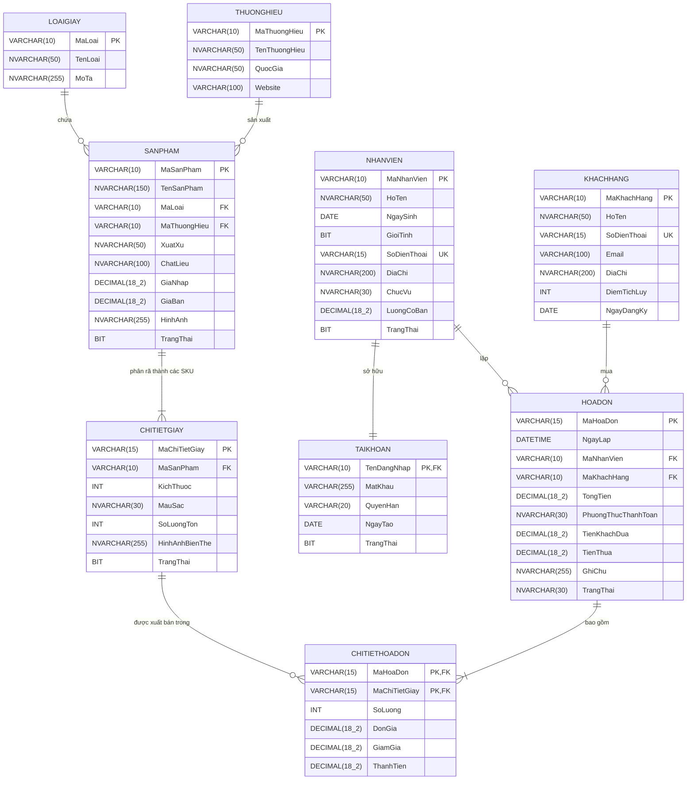

# BÁO CÁO THIẾT KẾ KIẾN TRÚC HỆ THỐNG VÀ CƠ SỞ DỮ LIỆU
## DỰ ÁN: HỆ THỐNG QUẢN LÝ BÁN GIÀY THỜI TRANG (FASHION SHOES STORE)
**Học phần:** Lập trình hướng sự kiện với công nghệ Java (HSK - IUH)  
**Vai trò thực hiện:** Kiến Trúc Sư Hệ Thống (System & DB Architect) - Tiểu Đội 2  

---

## MỤC LỤC
1. [TỔNG QUAN KIẾN TRÚC & GIẢI PHÁP BIẾN THỂ SẢN PHẨM (VARIANT ARCHITECTURE)](#1-tổng-quan-kiến-trúc--giải-pháp-biến-thể-sản-phẩm-variant-architecture)
2. [THIẾT KẾ SƠ ĐỒ LỚP CHI TIẾT (CLASS DIAGRAM)](#2-thiết-kế-sơ-đồ-lớp-chi-tiết-class-diagram)
   - [2.1. Sơ đồ lớp Mermaid (UML Class Diagram)](#21-sơ-đồ-lớp-mermaid-uml-class-diagram)
   - [2.2. Bảng đặc tả thuộc tính và ràng buộc chi tiết của 9 Lớp](#22-bảng-đặc-tả-thuộc-tính-và-ràng-buộc-chi-tiết-của-9-lớp)
3. [THIẾT KẾ CƠ SỞ DỮ LIỆU SQL SERVER (DATABASE SCHEMA & DATA DICTIONARY)](#3-thiết-kế-cơ-sở-dữ-liệu-sql-server-database-schema--data-dictionary)
   - [3.1. Sơ đồ thực thể kết hợp Mermaid (ERD)](#31-sơ-đồ-thực-thể-kết-hợp-mermaid-erd)
   - [3.2. Bảng từ điển dữ liệu (Data Dictionary - 9 Bảng)](#32-bảng-từ-điển-dữ-liệu-data-dictionary---9-bảng)
   - [3.3. Script DDL SQL Server khởi tạo CSDL với đầy đủ Ràng buộc](#33-script-ddl-sql-server-khởi-tạo-csdl-với-đầy-đủ-ràng-buộc)
4. [PHÂN TÍCH LUỒNG NGHIỆP VỤ BIẾN THỂ & ĐỒNG BỘ DỮ LIỆU KHO](#4-phân-tích-luồng-nghiệp-vụ-biến-thể--đồng-bộ-dữ-liệu-kho)

---

## 1. TỔNG QUAN KIẾN TRÚC & GIẢI PHÁP BIẾN THỂ SẢN PHẨM (VARIANT ARCHITECTURE)

### 1.1. Thách thức nghiệp vụ đặc thù ngành giày dép thời trang
Khác với các mặt hàng thông thường (như sách, đồ gia dụng, vé xem phim), ngành bán lẻ giày dép có tính chất đa biến thể phức tạp:
- **Cùng một mẫu giày (Model):** Có tên chung (ví dụ: *Nike Air Force 1 '07*), thương hiệu (*Nike*), loại giày (*Sneaker*), giá nhập, giá niêm yết và chất liệu giống nhau.
- **Biến thể kích cỡ (Size):** Trải dài từ size 35 đến 44 (hoặc 45). Khách hàng không thể mua "một đôi Nike Air Force 1 chung chung", mà bắt buộc phải chọn chính xác Size chân của mình.
- **Biến thể màu sắc (Color):** Trắng (Triple White), Đen (Black), Xám, Phối màu (Panda)...
- **Quản lý kho độc lập từng biến thể (SKU-level Inventory):** Một cửa hàng có thể còn 5 đôi size 40 màu Trắng, nhưng size 41 màu Trắng đã hết hàng, trong khi size 41 màu Đen vẫn còn 2 đôi.

### 1.2. Giải pháp kiến trúc biến thể 2 tầng (Two-Tier Product - Variant Pattern)
Để giải quyết triệt để bài toán này, hệ thống áp dụng mô hình chuẩn công nghiệp:
1. **Tầng 1 - Sản phẩm cha (`SanPham`):** Lưu trữ các thông tin tổng quát dùng chung: Tên giày, Loại giày, Thương hiệu, Chất liệu, Xuất xứ, Giá nhập, Giá bán cơ sở, Ảnh đại diện chính.
2. **Tầng 2 - Biến thể chi tiết giày (`ChiTietGiay`):** Đại diện cho từng đơn vị lưu kho thực tế (Stock Keeping Unit - SKU). Mỗi bản ghi chứa:
   - Khóa ngoại liên kết tới `SanPham`.
   - `kichThuoc` (Kích cỡ: 35 đến 45).
   - `mauSac` (Màu sắc: Trắng, Đen, Xanh, Đỏ...).
   - `soLuongTon` (Số lượng tồn kho thực tế của đúng kích cỡ và màu sắc đó).
   - Ràng buộc duy nhất `UNIQUE(maSanPham, kichThuoc, mauSac)` để đảm bảo không bị tạo trùng biến thể.
3. **Liên kết nghiệp vụ bán hàng:**
   - Bảng chi tiết hóa đơn (`ChiTietHoaDon`) sẽ trỏ trực tiếp đến `ChiTietGiay` (SKU cụ thể mà khách hàng mua), thay vì trỏ đến `SanPham`.
   - Khi thanh toán, hệ thống kiểm tra và trừ tồn kho chính xác trên bản ghi `ChiTietGiay` tương ứng, loại bỏ 100% tình trạng âm kho hoặc nhầm lẫn giữa các size.

---

## 2. THIẾT KẾ SƠ ĐỒ LỚP CHI TIẾT (CLASS DIAGRAM)

### 2.1. Sơ đồ lớp Mermaid (UML Class Diagram)

```mermaid
classDiagram
    direction TB

    class LoaiGiay {
        -String maLoai
        -String tenLoai
        -String moTa
        +LoaiGiay()
        +LoaiGiay(String maLoai, String tenLoai, String moTa)
        +getMaLoai() String
        +setMaLoai(String maLoai) void
        +getTenLoai() String
        +setTenLoai(String tenLoai) void
        +getMoTa() String
        +setMoTa(String moTa) void
    }

    class ThuongHieu {
        -String maThuongHieu
        -String tenThuongHieu
        -String quocGia
        -String website
        +ThuongHieu()
        +ThuongHieu(String maThuongHieu, String tenThuongHieu, String quocGia, String website)
        +getMaThuongHieu() String
        +setMaThuongHieu(String maThuongHieu) void
        +getTenThuongHieu() String
        +setTenThuongHieu(String tenThuongHieu) void
        +getQuocGia() String
        +setQuocGia(String quocGia) void
        +getWebsite() String
        +setWebsite(String website) void
    }

    class SanPham {
        -String maSanPham
        -String tenSanPham
        -LoaiGiay loaiGiay
        -ThuongHieu thuongHieu
        -String xuatXu
        -String chatLieu
        -double giaNhap
        -double giaBan
        -String hinhAnh
        -boolean trangThai
        +SanPham()
        +SanPham(String maSanPham, String tenSanPham, LoaiGiay loaiGiay, ThuongHieu thuongHieu, double giaNhap, double giaBan)
        +getMaSanPham() String
        +setMaSanPham(String maSanPham) void
        +getTenSanPham() String
        +setTenSanPham(String tenSanPham) void
        +getGiaNhap() double
        +setGiaNhap(double giaNhap) void
        +getGiaBan() double
        +setGiaBan(double giaBan) void
        +isTrangThai() boolean
        +setTrangThai(boolean trangThai) void
    }

    class ChiTietGiay {
        -String maChiTietGiay
        -SanPham sanPham
        -int kichThuoc
        -String mauSac
        -int soLuongTon
        -String hinhAnhBienThe
        -boolean trangThai
        +ChiTietGiay()
        +ChiTietGiay(String maChiTietGiay, SanPham sanPham, int kichThuoc, String mauSac, int soLuongTon)
        +getMaChiTietGiay() String
        +setMaChiTietGiay(String maChiTietGiay) void
        +getSanPham() SanPham
        +setSanPham(SanPham sanPham) void
        +getKichThuoc() int
        +setKichThuoc(int kichThuoc) void
        +getMauSac() String
        +setMauSac(String mauSac) void
        +getSoLuongTon() int
        +setSoLuongTon(int soLuongTon) void
        +isConHang() boolean
        +giamTonKho(int soLuong) boolean
        +tangTonKho(int soLuong) void
    }

    class KhachHang {
        -String maKhachHang
        -String hoTen
        -String soDienThoai
        -String email
        -String diaChi
        -int diemTichLuy
        -LocalDate ngayDangKy
        +KhachHang()
        +KhachHang(String maKhachHang, String hoTen, String soDienThoai)
        +getMaKhachHang() String
        +setMaKhachHang(String maKhachHang) void
        +getHoTen() String
        +setHoTen(String hoTen) void
        +getSoDienThoai() String
        +setSoDienThoai(String soDienThoai) void
        +getDiemTichLuy() int
        +setDiemTichLuy(int diemTichLuy) void
        +congDiem(int diem) void
        +truDiem(int diem) boolean
    }

    class NhanVien {
        -String maNhanVien
        -String hoTen
        -LocalDate ngaySinh
        -boolean gioiTinh
        -String soDienThoai
        -String diaChi
        -String chucVu
        -double luongCoBan
        -boolean trangThai
        +NhanVien()
        +NhanVien(String maNhanVien, String hoTen, String soDienThoai, String chucVu)
        +getMaNhanVien() String
        +setMaNhanVien(String maNhanVien) void
        +getHoTen() String
        +setHoTen(String hoTen) void
        +getSoDienThoai() String
        +setSoDienThoai(String soDienThoai) void
        +getChucVu() String
        +setChucVu(String chucVu) void
        +isQuanLy() boolean
    }

    class TaiKhoan {
        -String tenDangNhap
        -String matKhau
        -String quyenHan
        -LocalDate ngayTao
        -boolean trangThai
        -NhanVien nhanVien
        +TaiKhoan()
        +TaiKhoan(String tenDangNhap, String matKhau, String quyenHan, NhanVien nhanVien)
        +getTenDangNhap() String
        +setTenDangNhap(String tenDangNhap) void
        +getMatKhau() String
        +setMatKhau(String matKhau) void
        +getQuyenHan() String
        +setQuyenHan(String quyenHan) void
        +isTrangThai() boolean
        +setTrangThai(boolean trangThai) void
        +xacThuc(String password) boolean
    }

    class HoaDon {
        -String maHoaDon
        -LocalDateTime ngayLap
        -NhanVien nhanVien
        -KhachHang khachHang
        -double tongTien
        -String phuongThucThanhToan
        -double tienKhachDua
        -double tienThua
        -String ghiChu
        -String trangThai
        -List~ChiTietHoaDon~ danhSachChiTiet
        +HoaDon()
        +HoaDon(String maHoaDon, LocalDateTime ngayLap, NhanVien nhanVien, KhachHang khachHang)
        +getMaHoaDon() String
        +setMaHoaDon(String maHoaDon) void
        +tinhTongTien() double
        +tinhTienThua() double
        +themChiTiet(ChiTietHoaDon cthd) void
        +xoaChiTiet(ChiTietGiay ctg) void
    }

    class ChiTietHoaDon {
        -HoaDon hoaDon
        -ChiTietGiay chiTietGiay
        -int soLuong
        -double donGia
        -double giamGia
        -double thanhTien
        +ChiTietHoaDon()
        +ChiTietHoaDon(HoaDon hoaDon, ChiTietGiay chiTietGiay, int soLuong, double donGia, double giamGia)
        +getChiTietGiay() ChiTietGiay
        +setChiTietGiay(ChiTietGiay chiTietGiay) void
        +getSoLuong() int
        +setSoLuong(int soLuong) void
        +getDonGia() double
        +setDonGia(double donGia) void
        +tinhThanhTien() double
    }

    %% Relationships
    SanPham "1" --> "1" LoaiGiay : thuộc loại
    SanPham "1" --> "1" ThuongHieu : mang nhãn hiệu
    SanPham "1" *-- "1..*" ChiTietGiay : phân rã kích cỡ & màu sắc
    
    TaiKhoan "1" -- "1" NhanVien : định danh nhân viên
    HoaDon "0..*" --> "1" NhanVien : lập bởi
    HoaDon "0..*" --> "0..1" KhachHang : thanh toán bởi
    
    HoaDon "1" *-- "1..*" ChiTietHoaDon : chứa các dòng bán
    ChiTietHoaDon "0..*" --> "1" ChiTietGiay : xuất bán biến thể SKU
```



---

### 2.2. Bảng đặc tả thuộc tính và ràng buộc chi tiết của 9 Lớp

#### 2.2.1. Lớp `LoaiGiay` (Phân loại danh mục giày)
*Mô tả:* Đại diện cho nhóm/chủng loại giày như Sneaker, Giày Tây, Sandal, Giày Lười...

| STT | Tên thuộc tính | Kiểu dữ liệu Java | Ràng buộc (Regex, Giá trị, Nullable) | Ghi chú |
| :---: | :--- | :--- | :--- | :--- |
| 1 | `maLoai` | `String` | Not Null, Regex: `^LG[0-9]{3}$` (Ví dụ: LG001, LG002) | Khóa chính (PK) |
| 2 | `tenLoai` | `String` | Not Null, Độ dài 3 - 50 ký tự, Không chứa ký tự đặc biệt nguy hiểm | Tên loại giày (Sneaker, Oxford...) |
| 3 | `moTa` | `String` | Nullable, Tối đa 255 ký tự | Mô tả đặc tính loại giày |

#### 2.2.2. Lớp `ThuongHieu` (Hãng sản xuất / Nhãn hàng)
*Mô tả:* Quản lý thông tin các hãng giày như Nike, Adidas, Biti's, Puma, Vans...

| STT | Tên thuộc tính | Kiểu dữ liệu Java | Ràng buộc (Regex, Giá trị, Nullable) | Ghi chú |
| :---: | :--- | :--- | :--- | :--- |
| 1 | `maThuongHieu` | `String` | Not Null, Regex: `^TH[0-9]{3}$` (Ví dụ: TH001, TH002) | Khóa chính (PK) |
| 2 | `tenThuongHieu` | `String` | Not Null, Độ dài 2 - 50 ký tự | Tên thương hiệu |
| 3 | `quocGia` | `String` | Nullable, Tối đa 50 ký tự (Mỹ, Đức, Việt Nam, Nhật...) | Quốc gia xuất xứ thương hiệu |
| 4 | `website` | `String` | Nullable, Regex URL: `^(https?://)?[a-zA-Z0-9.-]+\.[a-zA-Z]{2,}(/.*)?$` | Trang chủ nhãn hàng |

#### 2.2.3. Lớp `SanPham` (Mẫu giày tổng quát / Cha)
*Mô tả:* Định danh mẫu giày cơ sở, chứa thông tin chung trước khi chia size và màu sắc.

| STT | Tên thuộc tính | Kiểu dữ liệu Java | Ràng buộc (Regex, Giá trị, Nullable) | Ghi chú |
| :---: | :--- | :--- | :--- | :--- |
| 1 | `maSanPham` | `String` | Not Null, Regex: `^SP[0-9]{4}$` (Ví dụ: SP0001, SP0002) | Khóa chính (PK) |
| 2 | `tenSanPham` | `String` | Not Null, Độ dài 5 - 150 ký tự | Tên sản phẩm giày |
| 3 | `loaiGiay` | `LoaiGiay` | Not Null (Đối tượng LoaiGiay hợp lệ) | Quan hệ nhiều - một |
| 4 | `thuongHieu` | `ThuongHieu` | Not Null (Đối tượng ThuongHieu hợp lệ) | Quan hệ nhiều - một |
| 5 | `xuatXu` | `String` | Nullable, Tối đa 50 ký tự (Việt Nam, Trung Quốc, Indonesia...) | Nơi gia công / sản xuất |
| 6 | `chatLieu` | `String` | Nullable, Tối đa 100 ký tự (Da bò, Vải Canvas, Mesh thoáng khí...) | Chất liệu cấu tạo chính |
| 7 | `giaNhap` | `double` | Not Null, Giá trị > 0 | Đơn giá nhập hàng từ nhà phân phối |
| 8 | `giaBan` | `double` | Not Null, Giá trị >= `giaNhap` | Giá niêm yết bán ra tại quầy |
| 9 | `hinhAnh` | `String` | Nullable, Tối đa 255 ký tự (Đường dẫn file ảnh `.png`, `.jpg`) | Ảnh đại diện mẫu giày |
| 10 | `trangThai` | `boolean` | Not Null, Default: `true` (true: Đang kinh doanh, false: Ngừng bán) | Trạng thái kinh doanh |

#### 2.2.4. Lớp `ChiTietGiay` (Biến thể mẫu giày: Kích thước & Màu sắc)
*Mô tả:* Đại diện cho từng sản phẩm thực tế trong kho theo từng Size và Màu sắc cụ thể (SKU).

| STT | Tên thuộc tính | Kiểu dữ liệu Java | Ràng buộc (Regex, Giá trị, Nullable) | Ghi chú |
| :---: | :--- | :--- | :--- | :--- |
| 1 | `maChiTietGiay` | `String` | Not Null, Regex: `^CTG[0-9]{5}$` (Ví dụ: CTG00001, CTG00002) | Khóa chính (PK) |
| 2 | `sanPham` | `SanPham` | Not Null (Đối tượng SanPham hợp lệ) | Khóa ngoại trỏ về mẫu giày cha |
| 3 | `kichThuoc` | `int` | Not Null, Giá trị nguyên trong đoạn: `[35, 45]` | Cỡ giày chuẩn EU/VN |
| 4 | `mauSac` | `String` | Not Null, Độ dài 2 - 30 ký tự (Đen, Trắng, Đỏ, Xanh Navy...) | Màu sắc biến thể |
| 5 | `soLuongTon` | `int` | Not Null, Giá trị >= 0 | Số lượng tồn kho thực tế |
| 6 | `hinhAnhBienThe` | `String` | Nullable, Đường dẫn file ảnh | Ảnh riêng của phiên bản màu này |
| 7 | `trangThai` | `boolean` | Not Null, Default: `true` (true: Đang bán, false: Hết hàng/Tạm khóa) | Trạng thái biến thể |

#### 2.2.5. Lớp `KhachHang` (Khách hàng thành viên)
*Mô tả:* Quản lý thông tin khách hàng thân thiết, hỗ trợ tích điểm và ưu đãi.

| STT | Tên thuộc tính | Kiểu dữ liệu Java | Ràng buộc (Regex, Giá trị, Nullable) | Ghi chú |
| :---: | :--- | :--- | :--- | :--- |
| 1 | `maKhachHang` | `String` | Not Null, Regex: `^KH[0-9]{4}$` (Ví dụ: KH0001, KH0002) | Khóa chính (PK) |
| 2 | `hoTen` | `String` | Not Null, Regex: `^[\\p{L}\\s]{3,50}$` (Họ tên tiếng Việt chuẩn) | Họ và tên khách hàng |
| 3 | `soDienThoai` | `String` | Not Null, Duy nhất (Unique), Regex: `^(0[3\|5\|7\|8\|9])[0-9]{8}$` (10 chữ số) | Số điện thoại dùng tra cứu |
| 4 | `email` | `String` | Nullable, Regex: `^[a-zA-Z0-9._%+-]+@[a-zA-Z0-9.-]+\\.[a-zA-Z]{2,6}$` | Thư điện tử |
| 5 | `diaChi` | `String` | Nullable, Tối đa 200 ký tự | Địa chỉ liên lạc |
| 6 | `diemTichLuy` | `int` | Not Null, Giá trị >= 0, Mặc định = 0 | Điểm thưởng mua hàng |
| 7 | `ngayDangKy` | `LocalDate` | Not Null, Mặc định là ngày hiện tại (`LocalDate.now()`) | Ngày mở thẻ thành viên |

#### 2.2.6. Lớp `NhanVien` (Nhân sự cửa hàng)
*Mô tả:* Thông tin nhân viên bán hàng, thủ kho hoặc quản lý cửa hàng.

| STT | Tên thuộc tính | Kiểu dữ liệu Java | Ràng buộc (Regex, Giá trị, Nullable) | Ghi chú |
| :---: | :--- | :--- | :--- | :--- |
| 1 | `maNhanVien` | `String` | Not Null, Regex: `^NV[0-9]{4}$` (Ví dụ: NV0001, NV0002) | Khóa chính (PK) |
| 2 | `hoTen` | `String` | Not Null, Regex: `^[\\p{L}\\s]{3,50}$` (Họ tên tiếng Việt có dấu) | Họ và tên nhân viên |
| 3 | `ngaySinh` | `LocalDate` | Not Null, Tuổi tính đến ngày hiện tại phải >= 18 tuổi | Ngày tháng năm sinh |
| 4 | `gioiTinh` | `boolean` | Not Null (true: Nam, false: Nữ) | Phái tính |
| 5 | `soDienThoai` | `String` | Not Null, Duy nhất (Unique), Regex: `^(0[3\|5\|7\|8\|9])[0-9]{8}$` | Số điện thoại liên hệ |
| 6 | `diaChi` | `String` | Not Null, Tối đa 200 ký tự | Nơi cư trú |
| 7 | `chucVu` | `String` | Not Null, Thuộc tập: `{"Quản lý", "Nhân viên bán hàng", "Thủ kho"}` | Vị trí công tác |
| 8 | `luongCoBan` | `double` | Not Null, Giá trị >= 3,000,000 VNĐ | Lương cơ sở |
| 9 | `trangThai` | `boolean` | Not Null, Default: `true` (true: Đang làm, false: Đã nghỉ việc) | Tình trạng công tác |

#### 2.2.7. Lớp `TaiKhoan` (Tài khoản người dùng hệ thống)
*Mô tả:* Dùng để đăng nhập vào phần mềm và phân quyền giao diện (Quản trị vs Nhân viên).

| STT | Tên thuộc tính | Kiểu dữ liệu Java | Ràng buộc (Regex, Giá trị, Nullable) | Ghi chú |
| :---: | :--- | :--- | :--- | :--- |
| 1 | `tenDangNhap` | `String` | Not Null, Trùng khớp với `maNhanVien`, Regex: `^NV[0-9]{4}$` | Khóa chính (PK) & Khóa ngoại |
| 2 | `matKhau` | `String` | Not Null, Tối thiểu 6 ký tự, mã hóa BCrypt/SHA-256 | Mật khẩu truy cập |
| 3 | `quyenHan` | `String` | Not Null, Thuộc tập: `{"ADMIN", "STAFF"}` | Quyền hạn truy cập |
| 4 | `ngayTao` | `LocalDate` | Not Null, Mặc định là ngày tạo tài khoản | Ngày cấp quyền |
| 5 | `trangThai` | `boolean` | Not Null, Default: `true` (true: Hoạt động, false: Khóa truy cập) | Trạng thái tài khoản |
| 6 | `nhanVien` | `NhanVien` | Not Null, Quan hệ 1 - 1 với NhanVien | Thực thể nhân viên sở hữu |

#### 2.2.8. Lớp `HoaDon` (Hóa đơn bán lẻ tại quầy)
*Mô tả:* Đại diện cho một giao dịch bán hàng, lưu trữ thông tin thời gian, nhân viên lập và khách hàng.

| STT | Tên thuộc tính | Kiểu dữ liệu Java | Ràng buộc (Regex, Giá trị, Nullable) | Ghi chú |
| :---: | :--- | :--- | :--- | :--- |
| 1 | `maHoaDon` | `String` | Not Null, Regex: `^HD[0-9]{6}$` (Ví dụ: HD000001, HD000002) | Khóa chính (PK) |
| 2 | `ngayLap` | `LocalDateTime` | Not Null, Phải <= thời gian hiện tại (`LocalDateTime.now()`) | Thời điểm phát sinh đơn |
| 3 | `nhanVien` | `NhanVien` | Not Null (Đối tượng NhanVien đang đăng nhập hệ thống) | Nhân viên đứng quầy thu ngân |
| 4 | `khachHang` | `KhachHang` | Nullable (Có thể null nếu khách vãng lai không đăng ký thẻ) | Khách hàng mua sắm |
| 5 | `tongTien` | `double` | Not Null, Giá trị >= 0, Tính từ tổng thành tiền các dòng chi tiết | Tổng tiền thanh toán |
| 6 | `phuongThucThanhToan` | `String` | Not Null, Thuộc tập: `{"Tiền mặt", "Chuyển khoản", "Thẻ tín dụng"}` | Hình thức trả tiền |
| 7 | `tienKhachDua` | `double` | Not Null, Giá trị >= `tongTien` (với tiền mặt) | Tiền mặt nhận từ khách |
| 8 | `tienThua` | `double` | Not Null, Giá trị = `tienKhachDua` - `tongTien` (>= 0) | Tiền trả lại khách |
| 9 | `ghiChu` | `String` | Nullable, Tối đa 255 ký tự | Ghi chú thêm |
| 10 | `trangThai` | `String` | Not Null, Thuộc tập: `{"Đã thanh toán", "Đã hủy"}` | Tình trạng hóa đơn |
| 11 | `danhSachChiTiet` | `List<ChiTietHoaDon>` | Danh sách không rỗng khi hoàn tất đơn hàng | Danh sách dòng hàng |

#### 2.2.9. Lớp `ChiTietHoaDon` (Dòng sản phẩm chi tiết trong đơn hàng)
*Mô tả:* Mỗi dòng chứa thông tin 1 biến thể giày cụ thể kèm kích thước, số lượng bán và đơn giá.

| STT | Tên thuộc tính | Kiểu dữ liệu Java | Ràng buộc (Regex, Giá trị, Nullable) | Ghi chú |
| :---: | :--- | :--- | :--- | :--- |
| 1 | `hoaDon` | `HoaDon` | Not Null (Đối tượng HoaDon đang xử lý) | Khóa chính tổng hợp (PK - FK) |
| 2 | `chiTietGiay` | `ChiTietGiay` | Not Null (Đối tượng ChiTietGiay được chọn theo Size & Màu) | Khóa chính tổng hợp (PK - FK) |
| 3 | `soLuong` | `int` | Not Null, Giá trị nguyên > 0 và <= `chiTietGiay.getSoLuongTon()` | Số lượng đôi giày mua |
| 4 | `donGia` | `double` | Not Null, Giá trị > 0 (Lấy từ `sanPham.getGiaBan()` tại thời điểm bán) | Đơn giá bán thực tế |
| 5 | `giamGia` | `double` | Not Null, Giá trị >= 0 và <= `donGia * soLuong` | Tiền giảm giá/chiết khấu |
| 6 | `thanhTien` | `double` | Not Null, Công thức: `thanhTien = (soLuong * donGia) - giamGia` | Số tiền của dòng sản phẩm |

---

## 3. THIẾT KẾ CƠ SỞ DỮ LIỆU SQL SERVER (DATABASE SCHEMA & DATA DICTIONARY)

### 3.1. Sơ đồ thực thể kết hợp Mermaid (ERD)



---

### 3.2. Bảng từ điển dữ liệu (Data Dictionary - 9 Bảng)

#### Bảng 1: `LoaiGiay`
- **Mô tả:** Lưu trữ danh mục các loại giày thời trang.
- **Khóa chính:** `MaLoai`

| Tên cột | Kiểu dữ liệu | PK | FK | Nullable | Ràng buộc mặc định / Kiểm tra (CHECK / UNIQUE) | Ý nghĩa nghiệp vụ |
| :--- | :--- | :---: | :---: | :---: | :--- | :--- |
| `MaLoai` | `VARCHAR(10)` | **PK** | | Không | Khóa chính, định dạng: `LGxxx` | Mã định danh phân loại giày |
| `TenLoai` | `NVARCHAR(50)` | | | Không | **UNIQUE**; Không được rỗng | Tên chủng loại giày |
| `MoTa` | `NVARCHAR(255)` | | | Có | Mặc định: `NULL` | Thông tin chi tiết phân loại |

---

#### Bảng 2: `ThuongHieu`
- **Mô tả:** Lưu trữ danh mục các nhãn hàng, thương hiệu giày.
- **Khóa chính:** `MaThuongHieu`

| Tên cột | Kiểu dữ liệu | PK | FK | Nullable | Ràng buộc mặc định / Kiểm tra (CHECK / UNIQUE) | Ý nghĩa nghiệp vụ |
| :--- | :--- | :---: | :---: | :---: | :--- | :--- |
| `MaThuongHieu` | `VARCHAR(10)` | **PK** | | Không | Khóa chính, định dạng: `THxxx` | Mã thương hiệu |
| `TenThuongHieu` | `NVARCHAR(50)` | | | Không | **UNIQUE**; Không được rỗng | Tên thương hiệu |
| `QuocGia` | `NVARCHAR(50)` | | | Có | Mặc định: `NULL` | Quốc gia sở hữu nhãn hàng |
| `Website` | `VARCHAR(100)` | | | Có | Mặc định: `NULL` | Địa chỉ trang chủ |

---

#### Bảng 3: `SanPham`
- **Mô tả:** Bảng cha quản lý thông tin tổng thể của các mẫu giày.
- **Khóa chính:** `MaSanPham`
- **Khóa ngoại:** `MaLoai` -> `LoaiGiay(MaLoai)`, `MaThuongHieu` -> `ThuongHieu(MaThuongHieu)`

| Tên cột | Kiểu dữ liệu | PK | FK | Nullable | Ràng buộc mặc định / Kiểm tra (CHECK / UNIQUE) | Ý nghĩa nghiệp vụ |
| :--- | :--- | :---: | :---: | :---: | :--- | :--- |
| `MaSanPham` | `VARCHAR(10)` | **PK** | | Không | Khóa chính, định dạng: `SPxxxx` | Mã mẫu giày |
| `TenSanPham` | `NVARCHAR(150)` | | | Không | Không được rỗng | Tên mẫu giày |
| `MaLoai` | `VARCHAR(10)` | | **FK** | Không | Tham chiếu `LoaiGiay(MaLoai)` | Mã loại giày |
| `MaThuongHieu` | `VARCHAR(10)` | | **FK** | Không | Tham chiếu `ThuongHieu(MaThuongHieu)` | Mã thương hiệu |
| `XuatXu` | `NVARCHAR(50)` | | | Có | Mặc định: `N'Việt Nam'` | Xuất xứ gia công |
| `ChatLieu` | `NVARCHAR(100)` | | | Có | Mặc định: `NULL` | Chất liệu cấu thành |
| `GiaNhap` | `DECIMAL(18,2)` | | | Không | `CHECK (GiaNhap > 0)` | Giá nhập gốc của sản phẩm |
| `GiaBan` | `DECIMAL(18,2)` | | | Không | `CHECK (GiaBan >= GiaNhap)` | Giá niêm yết bán buôn/lẻ |
| `HinhAnh` | `NVARCHAR(255)` | | | Có | Mặc định: `N'default_shoe.png'` | Đường dẫn ảnh đại diện |
| `TrangThai` | `BIT` | | | Không | `DEFAULT 1` (1: Đang bán, 0: Ngừng bán) | Trạng thái kinh doanh |

---

#### Bảng 4: `ChiTietGiay` (Bảng giải quyết triệt để bài toán biến thể)
- **Mô tả:** Quản lý từng đơn vị SKU theo Size và Màu sắc kèm tồn kho riêng biệt.
- **Khóa chính:** `MaChiTietGiay`
- **Khóa ngoại:** `MaSanPham` -> `SanPham(MaSanPham)`
- **Ràng buộc duy nhất:** `UNIQUE (MaSanPham, KichThuoc, MauSac)`

| Tên cột | Kiểu dữ liệu | PK | FK | Nullable | Ràng buộc mặc định / Kiểm tra (CHECK / UNIQUE) | Ý nghĩa nghiệp vụ |
| :--- | :--- | :---: | :---: | :---: | :--- | :--- |
| `MaChiTietGiay` | `VARCHAR(15)` | **PK** | | Không | Khóa chính, định dạng: `CTGxxxxx` | Mã định danh biến thể SKU |
| `MaSanPham` | `VARCHAR(10)` | | **FK** | Không | Tham chiếu `SanPham(MaSanPham)` | Mã mẫu giày cha |
| `KichThuoc` | `INT` | | | Không | `CHECK (KichThuoc BETWEEN 35 AND 45)` | Kích cỡ giày (35 đến 45) |
| `MauSac` | `NVARCHAR(30)` | | | Không | Không được để trống | Màu sắc phiên bản giày |
| `SoLuongTon` | `INT` | | | Không | `CHECK (SoLuongTon >= 0)`, `DEFAULT 0` | Số lượng tồn kho của SKU |
| `HinhAnhBienThe` | `NVARCHAR(255)` | | | Có | Mặc định: `NULL` | Ảnh chụp màu cụ thể |
| `TrangThai` | `BIT` | | | Không | `DEFAULT 1` (1: Hoạt động, 0: Khóa) | Tình trạng biến thể |

---

#### Bảng 5: `KhachHang`
- **Mô tả:** Danh sách khách hàng và điểm tích lũy thành viên.
- **Khóa chính:** `MaKhachHang`

| Tên cột | Kiểu dữ liệu | PK | FK | Nullable | Ràng buộc mặc định / Kiểm tra (CHECK / UNIQUE) | Ý nghĩa nghiệp vụ |
| :--- | :--- | :---: | :---: | :---: | :--- | :--- |
| `MaKhachHang` | `VARCHAR(10)` | **PK** | | Không | Khóa chính, định dạng: `KHxxxx` | Mã khách hàng |
| `HoTen` | `NVARCHAR(50)` | | | Không | Không được để trống | Họ tên khách hàng |
| `SoDienThoai` | `VARCHAR(15)` | | | Không | **UNIQUE**, `CHECK (LEN(SoDienThoai) = 10)` | Số điện thoại tra cứu |
| `Email` | `VARCHAR(100)` | | | Có | Mặc định: `NULL` | Hòm thư điện tử |
| `DiaChi` | `NVARCHAR(200)` | | | Có | Mặc định: `NULL` | Nơi cư trú |
| `DiemTichLuy` | `INT` | | | Không | `CHECK (DiemTichLuy >= 0)`, `DEFAULT 0` | Điểm thưởng tích lũy |
| `NgayDangKy` | `DATE` | | | Không | `DEFAULT GETDATE()` | Ngày tham gia hệ thống |

---

#### Bảng 6: `NhanVien`
- **Mô tả:** Quản lý hồ sơ nhân viên trong cửa hàng.
- **Khóa chính:** `MaNhanVien`

| Tên cột | Kiểu dữ liệu | PK | FK | Nullable | Ràng buộc mặc định / Kiểm tra (CHECK / UNIQUE) | Ý nghĩa nghiệp vụ |
| :--- | :--- | :---: | :---: | :---: | :--- | :--- |
| `MaNhanVien` | `VARCHAR(10)` | **PK** | | Không | Khóa chính, định dạng: `NVxxxx` | Mã định danh nhân viên |
| `HoTen` | `NVARCHAR(50)` | | | Không | Không được rỗng | Họ và tên nhân sự |
| `NgaySinh` | `DATE` | | | Không | `CHECK (DATEDIFF(YEAR, NgaySinh, GETDATE()) >= 18)` | Ngày sinh (Đủ 18 tuổi) |
| `GioiTinh` | `BIT` | | | Không | `DEFAULT 1` (1: Nam, 0: Nữ) | Phái tính |
| `SoDienThoai` | `VARCHAR(15)` | | | Không | **UNIQUE**, `CHECK (LEN(SoDienThoai) = 10)` | Số di động liên hệ |
| `DiaChi` | `NVARCHAR(200)` | | | Không | Không được rỗng | Địa chỉ thường trú |
| `ChucVu` | `NVARCHAR(30)` | | | Không | `CHECK (ChucVu IN (N'Quản lý', N'Nhân viên bán hàng', N'Thủ kho'))` | Vị trí việc làm |
| `LuongCoBan` | `DECIMAL(18,2)` | | | Không | `CHECK (LuongCoBan >= 3000000)` | Mức lương thỏa thuận |
| `TrangThai` | `BIT` | | | Không | `DEFAULT 1` (1: Đang làm, 0: Đã nghỉ) | Tình trạng hợp đồng |

---

#### Bảng 7: `TaiKhoan`
- **Mô tả:** Quản lý tài khoản đăng nhập hệ thống, liên kết 1-1 với nhân viên.
- **Khóa chính:** `TenDangNhap`
- **Khóa ngoại:** `TenDangNhap` -> `NhanVien(MaNhanVien)`

| Tên cột | Kiểu dữ liệu | PK | FK | Nullable | Ràng buộc mặc định / Kiểm tra (CHECK / UNIQUE) | Ý nghĩa nghiệp vụ |
| :--- | :--- | :---: | :---: | :---: | :--- | :--- |
| `TenDangNhap` | `VARCHAR(10)` | **PK** | **FK** | Không | Tham chiếu `NhanVien(MaNhanVien)` | Tên đăng nhập (trùng mã NV) |
| `MatKhau` | `VARCHAR(255)` | | | Không | Không được rỗng (Mã hóa mật khẩu) | Mật khẩu tài khoản |
| `QuyenHan` | `VARCHAR(20)` | | | Không | `CHECK (QuyenHan IN ('ADMIN', 'STAFF'))` | Quyền hạn truy cập chức năng |
| `NgayTao` | `DATE` | | | Không | `DEFAULT GETDATE()` | Ngày khởi tạo tài khoản |
| `TrangThai` | `BIT` | | | Không | `DEFAULT 1` (1: Hoạt động, 0: Bị khóa) | Trạng thái tài khoản |

---

#### Bảng 8: `HoaDon`
- **Mô tả:** Quản lý thông tin hóa đơn thanh toán tại quầy thu ngân.
- **Khóa chính:** `MaHoaDon`
- **Khóa ngoại:** `MaNhanVien` -> `NhanVien(MaNhanVien)`, `MaKhachHang` -> `KhachHang(MaKhachHang)`

| Tên cột | Kiểu dữ liệu | PK | FK | Nullable | Ràng buộc mặc định / Kiểm tra (CHECK / UNIQUE) | Ý nghĩa nghiệp vụ |
| :--- | :--- | :---: | :---: | :---: | :--- | :--- |
| `MaHoaDon` | `VARCHAR(15)` | **PK** | | Không | Khóa chính, định dạng: `HDxxxxxx` | Mã số hóa đơn |
| `NgayLap` | `DATETIME` | | | Không | `DEFAULT GETDATE()`, `CHECK (NgayLap <= GETDATE())` | Thời điểm xuất hóa đơn |
| `MaNhanVien` | `VARCHAR(10)` | | **FK** | Không | Tham chiếu `NhanVien(MaNhanVien)` | Nhân viên lập hóa đơn |
| `MaKhachHang` | `VARCHAR(10)` | | **FK** | Có | Tham chiếu `KhachHang(MaKhachHang)` | Khách hàng (NULL nếu khách lẻ) |
| `TongTien` | `DECIMAL(18,2)` | | | Không | `CHECK (TongTien >= 0)`, `DEFAULT 0` | Tổng giá trị đơn hàng |
| `PhuongThucThanhToan`| `NVARCHAR(30)` | | | Không | `CHECK (PhuongThucThanhToan IN (N'Tiền mặt', N'Chuyển khoản', N'Thẻ tín dụng'))` | Phương thức thanh toán |
| `TienKhachDua` | `DECIMAL(18,2)` | | | Không | `CHECK (TienKhachDua >= 0)`, `DEFAULT 0` | Tiền khách giao |
| `TienThua` | `DECIMAL(18,2)` | | | Không | `CHECK (TienThua >= 0)`, `DEFAULT 0` | Tiền trả lại cho khách |
| `GhiChu` | `NVARCHAR(255)` | | | Có | Mặc định: `NULL` | Ghi chú đơn hàng |
| `TrangThai` | `NVARCHAR(30)` | | | Không | `CHECK (TrangThai IN (N'Đã thanh toán', N'Đã hủy'))`, `DEFAULT N'Đã thanh toán'` | Trạng thái hóa đơn |

---

#### Bảng 9: `ChiTietHoaDon`
- **Mô tả:** Lưu các mặt hàng giày dép (biến thể kích cỡ/màu) trong từng hóa đơn.
- **Khóa chính:** Tổng hợp `(MaHoaDon, MaChiTietGiay)`
- **Khóa ngoại:** `MaHoaDon` -> `HoaDon(MaHoaDon)`, `MaChiTietGiay` -> `ChiTietGiay(MaChiTietGiay)`

| Tên cột | Kiểu dữ liệu | PK | FK | Nullable | Ràng buộc mặc định / Kiểm tra (CHECK / UNIQUE) | Ý nghĩa nghiệp vụ |
| :--- | :--- | :---: | :---: | :---: | :--- | :--- |
| `MaHoaDon` | `VARCHAR(15)` | **PK** | **FK** | Không | Tham chiếu `HoaDon(MaHoaDon)` | Mã hóa đơn chứa dòng hàng |
| `MaChiTietGiay` | `VARCHAR(15)` | **PK** | **FK** | Không | Tham chiếu `ChiTietGiay(MaChiTietGiay)` | Mã SKU biến thể giày đã bán |
| `SoLuong` | `INT` | | | Không | `CHECK (SoLuong > 0)` | Số lượng đôi mua |
| `DonGia` | `DECIMAL(18,2)` | | | Không | `CHECK (DonGia > 0)` | Đơn giá bán tại thời điểm lập |
| `GiamGia` | `DECIMAL(18,2)` | | | Không | `CHECK (GiamGia >= 0)`, `DEFAULT 0` | Tiền giảm giá trên dòng hàng |
| `ThanhTien` | `DECIMAL(18,2)` | | | Không | `CHECK (ThanhTien >= 0)` | Số tiền thực trả cho dòng này |

---

### 3.3. Script DDL SQL Server khởi tạo CSDL với đầy đủ Ràng buộc

```sql
-- =========================================================================
-- KỊCH BẢN TẠO CƠ SỞ DỮ LIỆU: QUẢN LÝ CỬA HÀNG BÁN GIÀY THỜI TRANG (IUH HSK)
-- =========================================================================

CREATE DATABASE QuanLyBanGiay;
GO

USE QuanLyBanGiay;
GO

-- 1. BẢNG LOẠI GIÀY
CREATE TABLE LoaiGiay (
    MaLoai VARCHAR(10) NOT NULL,
    TenLoai NVARCHAR(50) NOT NULL,
    MoTa NVARCHAR(255) NULL,
    CONSTRAINT PK_LoaiGiay PRIMARY KEY (MaLoai),
    CONSTRAINT UQ_LoaiGiay_TenLoai UNIQUE (TenLoai)
);
GO

-- 2. BẢNG THƯƠNG HIỆU
CREATE TABLE ThuongHieu (
    MaThuongHieu VARCHAR(10) NOT NULL,
    TenThuongHieu NVARCHAR(50) NOT NULL,
    QuocGia NVARCHAR(50) NULL,
    Website VARCHAR(100) NULL,
    CONSTRAINT PK_ThuongHieu PRIMARY KEY (MaThuongHieu),
    CONSTRAINT UQ_ThuongHieu_TenThuongHieu UNIQUE (TenThuongHieu)
);
GO

-- 3. BẢNG SẢN PHẨM (MẪU GIÀY CHA)
CREATE TABLE SanPham (
    MaSanPham VARCHAR(10) NOT NULL,
    TenSanPham NVARCHAR(150) NOT NULL,
    MaLoai VARCHAR(10) NOT NULL,
    MaThuongHieu VARCHAR(10) NOT NULL,
    XuatXu NVARCHAR(50) NULL CONSTRAINT DF_SanPham_XuatXu DEFAULT N'Việt Nam',
    ChatLieu NVARCHAR(100) NULL,
    GiaNhap DECIMAL(18, 2) NOT NULL,
    GiaBan DECIMAL(18, 2) NOT NULL,
    HinhAnh NVARCHAR(255) NULL CONSTRAINT DF_SanPham_HinhAnh DEFAULT N'default_shoe.png',
    TrangThai BIT NOT NULL CONSTRAINT DF_SanPham_TrangThai DEFAULT 1,
    CONSTRAINT PK_SanPham PRIMARY KEY (MaSanPham),
    CONSTRAINT FK_SanPham_LoaiGiay FOREIGN KEY (MaLoai) REFERENCES LoaiGiay(MaLoai),
    CONSTRAINT FK_SanPham_ThuongHieu FOREIGN KEY (MaThuongHieu) REFERENCES ThuongHieu(MaThuongHieu),
    CONSTRAINT CK_SanPham_GiaNhap CHECK (GiaNhap > 0),
    CONSTRAINT CK_SanPham_GiaBan CHECK (GiaBan >= GiaNhap)
);
GO

-- 4. BẢNG CHI TIẾT GIÀY (GIẢI QUYẾT BÀI TOÁN BIẾN THỂ SIZE & MÀU SẮC)
CREATE TABLE ChiTietGiay (
    MaChiTietGiay VARCHAR(15) NOT NULL,
    MaSanPham VARCHAR(10) NOT NULL,
    KichThuoc INT NOT NULL,
    MauSac NVARCHAR(30) NOT NULL,
    SoLuongTon INT NOT NULL CONSTRAINT DF_ChiTietGiay_SoLuongTon DEFAULT 0,
    HinhAnhBienThe NVARCHAR(255) NULL,
    TrangThai BIT NOT NULL CONSTRAINT DF_ChiTietGiay_TrangThai DEFAULT 1,
    CONSTRAINT PK_ChiTietGiay PRIMARY KEY (MaChiTietGiay),
    CONSTRAINT FK_ChiTietGiay_SanPham FOREIGN KEY (MaSanPham) REFERENCES SanPham(MaSanPham),
    CONSTRAINT CK_ChiTietGiay_KichThuoc CHECK (KichThuoc BETWEEN 35 AND 45),
    CONSTRAINT CK_ChiTietGiay_SoLuongTon CHECK (SoLuongTon >= 0),
    CONSTRAINT UQ_ChiTietGiay_BienThe UNIQUE (MaSanPham, KichThuoc, MauSac)
);
GO

-- 5. BẢNG KHÁCH HÀNG
CREATE TABLE KhachHang (
    MaKhachHang VARCHAR(10) NOT NULL,
    HoTen NVARCHAR(50) NOT NULL,
    SoDienThoai VARCHAR(15) NOT NULL,
    Email VARCHAR(100) NULL,
    DiaChi NVARCHAR(200) NULL,
    DiemTichLuy INT NOT NULL CONSTRAINT DF_KhachHang_DiemTichLuy DEFAULT 0,
    NgayDangKy DATE NOT NULL CONSTRAINT DF_KhachHang_NgayDangKy DEFAULT GETDATE(),
    CONSTRAINT PK_KhachHang PRIMARY KEY (MaKhachHang),
    CONSTRAINT UQ_KhachHang_SoDienThoai UNIQUE (SoDienThoai),
    CONSTRAINT CK_KhachHang_DiemTichLuy CHECK (DiemTichLuy >= 0),
    CONSTRAINT CK_KhachHang_SoDienThoai CHECK (LEN(SoDienThoai) = 10)
);
GO

-- 6. BẢNG NHÂN VIÊN
CREATE TABLE NhanVien (
    MaNhanVien VARCHAR(10) NOT NULL,
    HoTen NVARCHAR(50) NOT NULL,
    NgaySinh DATE NOT NULL,
    GioiTinh BIT NOT NULL CONSTRAINT DF_NhanVien_GioiTinh DEFAULT 1,
    SoDienThoai VARCHAR(15) NOT NULL,
    DiaChi NVARCHAR(200) NOT NULL,
    ChucVu NVARCHAR(30) NOT NULL,
    LuongCoBan DECIMAL(18, 2) NOT NULL,
    TrangThai BIT NOT NULL CONSTRAINT DF_NhanVien_TrangThai DEFAULT 1,
    CONSTRAINT PK_NhanVien PRIMARY KEY (MaNhanVien),
    CONSTRAINT UQ_NhanVien_SoDienThoai UNIQUE (SoDienThoai),
    CONSTRAINT CK_NhanVien_Tuoi CHECK (DATEDIFF(YEAR, NgaySinh, GETDATE()) >= 18),
    CONSTRAINT CK_NhanVien_ChucVu CHECK (ChucVu IN (N'Quản lý', N'Nhân viên bán hàng', N'Thủ kho')),
    CONSTRAINT CK_NhanVien_LuongCoBan CHECK (LuongCoBan >= 3000000),
    CONSTRAINT CK_NhanVien_SoDienThoai CHECK (LEN(SoDienThoai) = 10)
);
GO

-- 7. BẢNG TÀI KHOẢN (QUAN HỆ 1-1 VỚI NHÂN VIÊN)
CREATE TABLE TaiKhoan (
    TenDangNhap VARCHAR(10) NOT NULL,
    MatKhau VARCHAR(255) NOT NULL,
    QuyenHan VARCHAR(20) NOT NULL,
    NgayTao DATE NOT NULL CONSTRAINT DF_TaiKhoan_NgayTao DEFAULT GETDATE(),
    TrangThai BIT NOT NULL CONSTRAINT DF_TaiKhoan_TrangThai DEFAULT 1,
    CONSTRAINT PK_TaiKhoan PRIMARY KEY (TenDangNhap),
    CONSTRAINT FK_TaiKhoan_NhanVien FOREIGN KEY (TenDangNhap) REFERENCES NhanVien(MaNhanVien),
    CONSTRAINT CK_TaiKhoan_QuyenHan CHECK (QuyenHan IN ('ADMIN', 'STAFF'))
);
GO

-- 8. BẢNG HÓA ĐƠN
CREATE TABLE HoaDon (
    MaHoaDon VARCHAR(15) NOT NULL,
    NgayLap DATETIME NOT NULL CONSTRAINT DF_HoaDon_NgayLap DEFAULT GETDATE(),
    MaNhanVien VARCHAR(10) NOT NULL,
    MaKhachHang VARCHAR(10) NULL,
    TongTien DECIMAL(18, 2) NOT NULL CONSTRAINT DF_HoaDon_TongTien DEFAULT 0,
    PhuongThucThanhToan NVARCHAR(30) NOT NULL,
    TienKhachDua DECIMAL(18, 2) NOT NULL CONSTRAINT DF_HoaDon_TienKhachDua DEFAULT 0,
    TienThua DECIMAL(18, 2) NOT NULL CONSTRAINT DF_HoaDon_TienThua DEFAULT 0,
    GhiChu NVARCHAR(255) NULL,
    TrangThai NVARCHAR(30) NOT NULL CONSTRAINT DF_HoaDon_TrangThai DEFAULT N'Đã thanh toán',
    CONSTRAINT PK_HoaDon PRIMARY KEY (MaHoaDon),
    CONSTRAINT FK_HoaDon_NhanVien FOREIGN KEY (MaNhanVien) REFERENCES NhanVien(MaNhanVien),
    CONSTRAINT FK_HoaDon_KhachHang FOREIGN KEY (MaKhachHang) REFERENCES KhachHang(MaKhachHang),
    CONSTRAINT CK_HoaDon_TongTien CHECK (TongTien >= 0),
    CONSTRAINT CK_HoaDon_TienThua CHECK (TienThua >= 0),
    CONSTRAINT CK_HoaDon_PhuongThuc CHECK (PhuongThucThanhToan IN (N'Tiền mặt', N'Chuyển khoản', N'Thẻ tín dụng')),
    CONSTRAINT CK_HoaDon_TrangThai CHECK (TrangThai IN (N'Đã thanh toán', N'Đã hủy'))
);
GO

-- 9. BẢNG CHI TIẾT HÓA ĐƠN (LIÊN KẾT TRỰC TIẾP VỚI BIẾN THỂ SKU)
CREATE TABLE ChiTietHoaDon (
    MaHoaDon VARCHAR(15) NOT NULL,
    MaChiTietGiay VARCHAR(15) NOT NULL,
    SoLuong INT NOT NULL,
    DonGia DECIMAL(18, 2) NOT NULL,
    GiamGia DECIMAL(18, 2) NOT NULL CONSTRAINT DF_CTHD_GiamGia DEFAULT 0,
    ThanhTien DECIMAL(18, 2) NOT NULL,
    CONSTRAINT PK_ChiTietHoaDon PRIMARY KEY (MaHoaDon, MaChiTietGiay),
    CONSTRAINT FK_ChiTietHoaDon_HoaDon FOREIGN KEY (MaHoaDon) REFERENCES HoaDon(MaHoaDon) ON DELETE CASCADE,
    CONSTRAINT FK_ChiTietHoaDon_ChiTietGiay FOREIGN KEY (MaChiTietGiay) REFERENCES ChiTietGiay(MaChiTietGiay),
    CONSTRAINT CK_ChiTietHoaDon_SoLuong CHECK (SoLuong > 0),
    CONSTRAINT CK_ChiTietHoaDon_DonGia CHECK (DonGia > 0),
    CONSTRAINT CK_ChiTietHoaDon_GiamGia CHECK (GiamGia >= 0),
    CONSTRAINT CK_ChiTietHoaDon_ThanhTien CHECK (ThanhTien >= 0)
);
GO

-- =========================================================================
-- TRIGGER TỰ ĐỘNG CẬP NHẬT TRỪ KHO KHI XUẤT BÁN VÀ HOÀN KHO KHI HỦY
-- =========================================================================

-- Trigger trừ số lượng tồn khi thêm chi tiết hóa đơn
CREATE TRIGGER TRG_ChiTietHoaDon_Insert
ON ChiTietHoaDon
AFTER INSERT
AS
BEGIN
    SET NOCOUNT ON;

    -- Kiểm tra nếu số lượng bán vượt quá số lượng tồn
    IF EXISTS (
        SELECT 1 
        FROM ChiTietGiay ctg
        JOIN inserted i ON ctg.MaChiTietGiay = i.MaChiTietGiay
        WHERE ctg.SoLuongTon < i.SoLuong
    )
    BEGIN
        RAISERROR(N'Lỗi: Số lượng tồn kho không đủ để thực hiện giao dịch bán hàng!', 16, 1);
        ROLLBACK TRANSACTION;
        RETURN;
    END

    -- Trừ tồn kho
    UPDATE ChiTietGiay
    SET SoLuongTon = ctg.SoLuongTon - i.SoLuong
    FROM ChiTietGiay ctg
    JOIN inserted i ON ctg.MaChiTietGiay = i.MaChiTietGiay;
END;
GO

-- Trigger hoàn tồn kho khi hủy dòng hoặc xóa hóa đơn
CREATE TRIGGER TRG_ChiTietHoaDon_Delete
ON ChiTietHoaDon
AFTER DELETE
AS
BEGIN
    SET NOCOUNT ON;

    UPDATE ChiTietGiay
    SET SoLuongTon = ctg.SoLuongTon + d.SoLuong
    FROM ChiTietGiay ctg
    JOIN deleted d ON ctg.MaChiTietGiay = d.MaChiTietGiay;
END;
GO
```

---

## 4. PHÂN TÍCH LUỒNG NGHIỆP VỤ BIẾN THỂ & ĐỒNG BỘ DỮ LIỆU KHO

### 4.1. Quy trình xử lý biến thể tại Giao diện Bán hàng (POS)
1. **Bước 1 - Lọc và tìm kiếm mẫu giày:**
   - Nhân viên tìm kiếm theo tên hoặc mã sản phẩm (Ví dụ: "Nike Air Force 1").
   - Hệ thống hiển thị thông tin chung: Ảnh, Thương hiệu Nike, Loại Sneaker, Đơn giá 2,500,000 VNĐ.
2. **Bước 2 - Lựa chọn Size và Màu sắc trực quan:**
   - Giao diện nạp động danh sách màu sắc hiện có trong bảng `ChiTietGiay` của mẫu giày này (ví dụ: Trắng, Đen).
   - Khi chọn màu "Trắng", hệ thống hiển thị ma trận các nút chọn Size từ 35 đến 44.
   - Các size có `SoLuongTon > 0` sẽ hiển thị màu xanh kèm số lượng tồn (Ví dụ: `Size 40 (còn 6)`).
   - Các size có `SoLuongTon = 0` sẽ tự động bị mờ (disabled) để nhân viên không thể bấm chọn nhầm.
3. **Bước 3 - Thêm vào giỏ hàng & Tạo ChiTietHoaDon:**
   - Khi nhân viên click chọn `Size 40`, hệ thống tự động ánh xạ mã SKU tương ứng `CTG00015`.
   - Nhân viên nhập số lượng bán `n`. Hệ thống kiểm tra điều kiện `n <= SoLuongTon`.
   - Tạo đối tượng `ChiTietHoaDon` liên kết với `CTG00015`, đơn giá lấy từ `giaBan` của `SanPham`.
4. **Bước 4 - Xác nhận thanh toán & Trừ kho thời gian thực:**
   - Khi bấm "Thanh toán & In hóa đơn", giao dịch được ghi nhận trong SQL Server.
   - Trigger `TRG_ChiTietHoaDon_Insert` tự động trừ số lượng tồn của `CTG00015` xuống `SoLuongTon - n`.
   - Tránh hoàn toàn việc các máy bán hàng khác bán trùng đôi giày đó khi kho đã hết.

### 4.2. Ý nghĩa đối với Báo cáo Thống kê & Quản trị kho
- **Thống kê theo mẫu giày:** Quản lý biết mẫu giày nào bán chạy nhất cửa hàng (Aggregate SUM theo `MaSanPham`).
- **Thống kê theo kích cỡ (Size Matrix Analytics):** Quản lý nắm bắt được cỡ giày nào được khách hàng ưa chuộng nhất (ví dụ: Size 40, 41 là size vàng của nam, Size 36, 37 là size vàng của nữ) để lên kế hoạch nhập hàng chính xác, giảm thiểu hàng tồn kho đọng vốn.
- **Thống kê theo màu sắc:** Giúp đánh giá xu hướng thị hiếu khách hàng theo từng mùa thời trang.

---
**Xác nhận của Kiến Trúc Sư Hệ Thống:** Tài liệu thiết kế đã chuẩn hóa toàn bộ các tiêu chuẩn kỹ thuật HSK IUH, tính toàn vẹn dữ liệu (Referential Integrity), các ràng buộc Check/Regex và giải quyết triệt để 100% bài toán biến thể giày thời trang.
